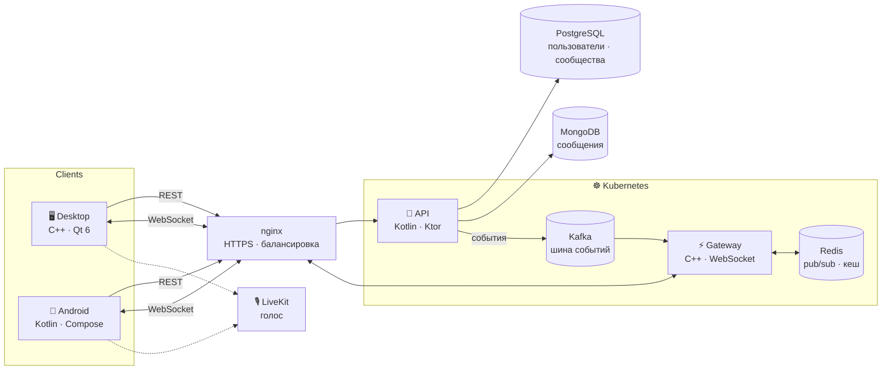

<div align="center">


<a href="https://github.com/Bananka123321">
  
</a>

<br>

<a href="https://t.me/M1CROmash"></a>
<a href="mailto:obuhov.i2007@gmail.com"></a>
<a href="https://habr.com/ru/users/Bananka123321/"></a>


</div>

<br>

<table>
<tr>
<td width="58%" valign="top">

### `$ whoami`

```cpp
struct Ivan final {
    std::string_view study  = "ТПУ, 3 курс";
    std::string_view role   = "C++ · системное и сетевое программирование";
    std::string_view os     = "Fedora Linux";

    std::array<std::string_view, 4> loves {
        "многопоточность", "сокеты и протоколы",
        "производительность", "работа с памятью"
    };

    [[nodiscard]] auto looking_for() const noexcept {
        return "удалённая стажировка: C++ Backend / Network";
    }
};
```

</td>
<td width="42%" valign="top">

### `$ cat now.log`

```diff
+ Fortal: C++ WebSocket gateway
+ Ivan-Messenger: передача файлов
+ Kafka, Kubernetes, Redis
+ NAT traversal, STUN / TURN
+ C++20: concepts, ranges,
+        coroutines
- «на моей машине работает»
```

</td>
</tr>
</table>

Люблю понимать, как всё устроено на самом деле, от аллокаций до байтов в TCP-потоке. Довожу задачи до конца: с тестами, CI и релизами.


## 🛰️ Fortal: аналог Discord на микросервисах

<a href="https://github.com/Fortal-Chat/Fortal"></a>


Делаем вдвоём с напарником: сообщества, каналы, личные сообщения, потом голос. Архитектура с самого начала рассчитана на нагрузку и горизонтальное масштабирование. Моя зона: **C++ gateway** реального времени и **desktop-клиент на Qt 6**.



<sub>Целевая архитектура. Строим поэтапно: сначала договор API, Docker Compose и PostgreSQL, затем gateway, брокер, выкладка и масштабирование по замерам.</sub>

## 🚀 Другие проекты

<table>
<tr>
<td width="50%" valign="top">

### 💬 [Ivan-Messenger](https://github.com/Bananka123321/Ivan-Messenger)
Мессенджер с шифрованием, написанный с нуля.

- свой сервер на POSIX-сокетах + **OpenSSL TLS**
- **Argon2** для паролей, восстановление сессии без повторного входа
- **PostgreSQL** через пул соединений (libpqxx)
- файлы чанками с докачкой, кеш на клиенте в **SQLite**
- клиент на **Qt 6 / QML** (MVVM): Linux, Windows, Android
- контрактные тесты протокола, **GTest**, релизы через **GitHub Actions**

    

</td>
<td width="50%" valign="top">

### 🚢 [Sea Battle](https://github.com/Bananka123321/Sea_Battle)
Сетевой «Морской бой» для двух игроков.

- сервер с лобби и игровыми сессиями, вход по коду комнаты
- синхронизация состояния игры по TCP
- общий протокол и валидация для клиента и сервера
- Qt 6 Widgets + Qt Multimedia
- Winsock2 / POSIX-сокеты: Windows и Linux

  

<sub>вместе с <a href="https://github.com/pomidorchik03">pomidorchik03</a></sub>

</td>
</tr>
</table>


## 🛠 Стек

<div align="center">

<table>
<tr>
<th>⚙️ Языки и фреймворки</th>
<th>🗄️ Данные</th>
</tr>
<tr>
<td align="center"></td>
<td align="center"></td>
</tr>
<tr>
<th>🌐 Инфраструктура</th>
<th>🧰 Инструменты</th>
</tr>
<tr>
<td align="center"></td>
<td align="center"></td>
</tr>
</table>

<sub>а также OpenSSL · libpqxx · Argon2 · GTest · nlohmann/json · POSIX sockets · WebSocket · LiveKit</sub>

</div>

## 📊 Активность

<div align="center">


</div>

## 🎯 Цель

> Ищу **удалённую стажировку** в C++ Backend / Network разработке. Хочу решать настоящие задачи рядом с сильными инженерами и вырасти в сетевого C++ разработчика, который работает над высоконагруженными системами: мессенджерами, финтехом, трейдингом.

<div align="center">

<br>

<sub><i>«Код читается чаще, чем пишется. Поэтому я стараюсь писать его так, чтобы не стыдно было показать.»</i></sub>


</div>
